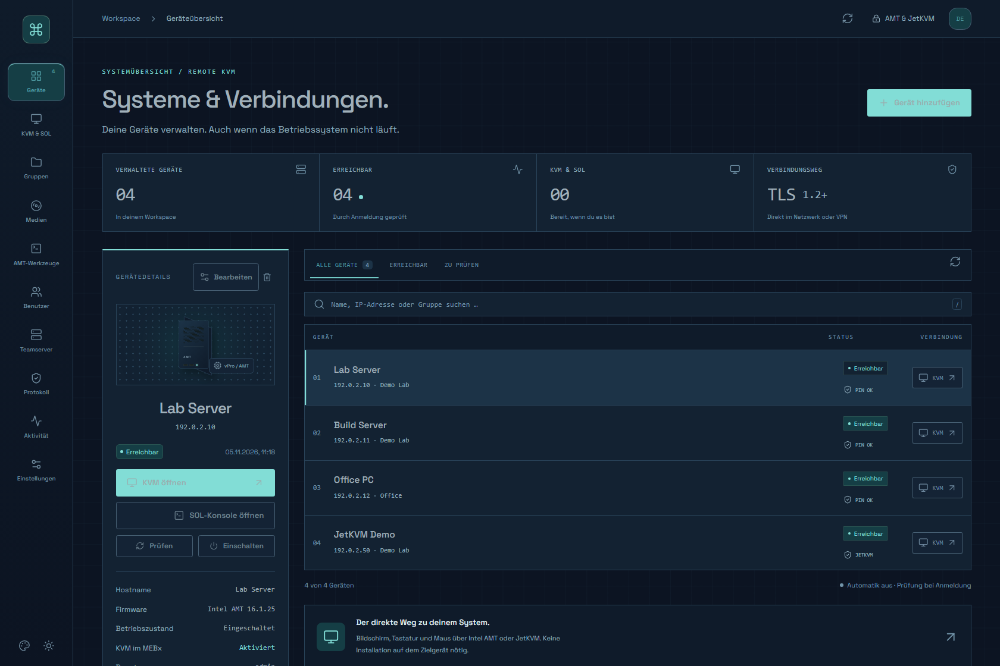
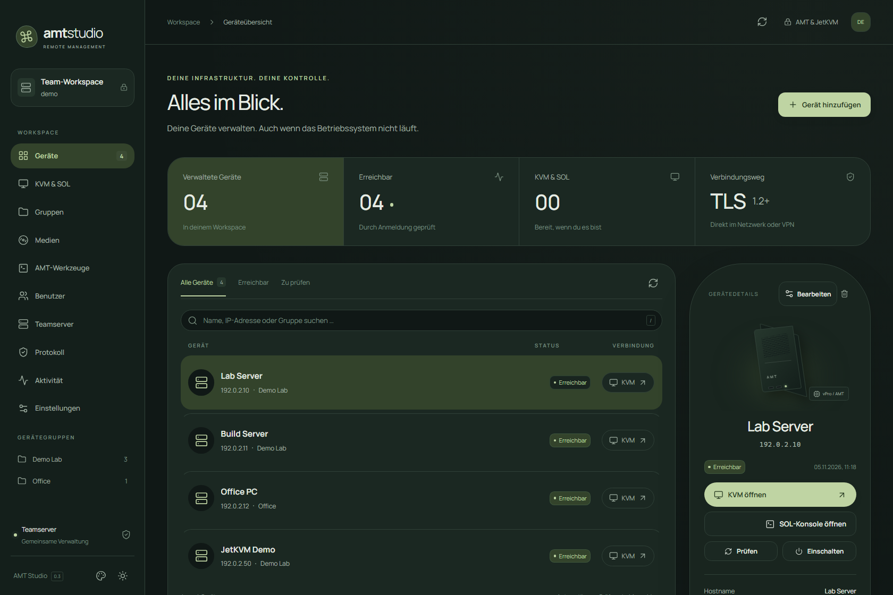
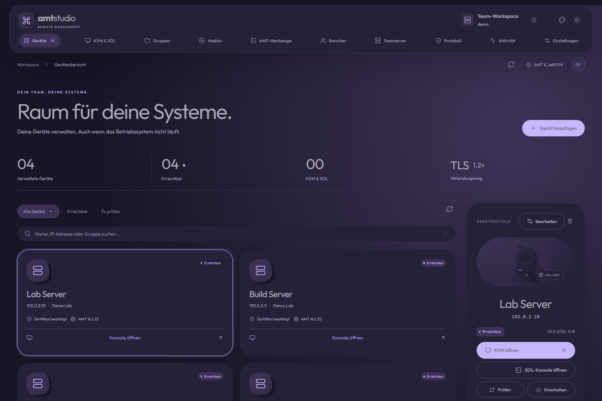
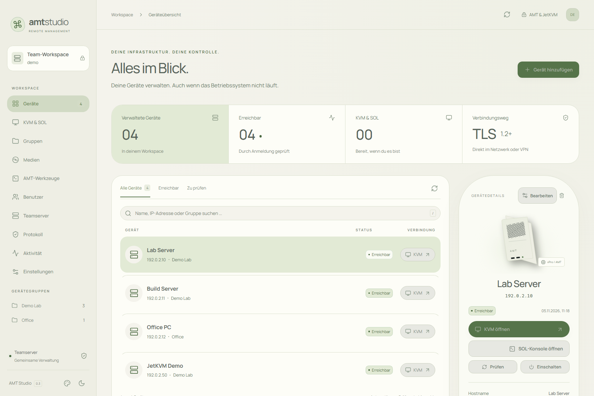
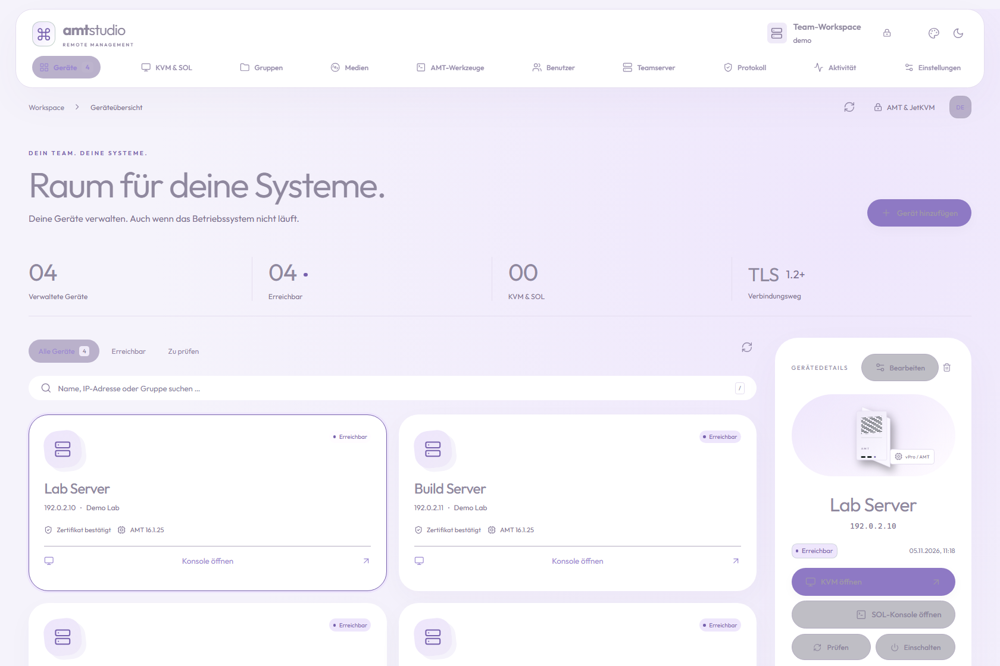
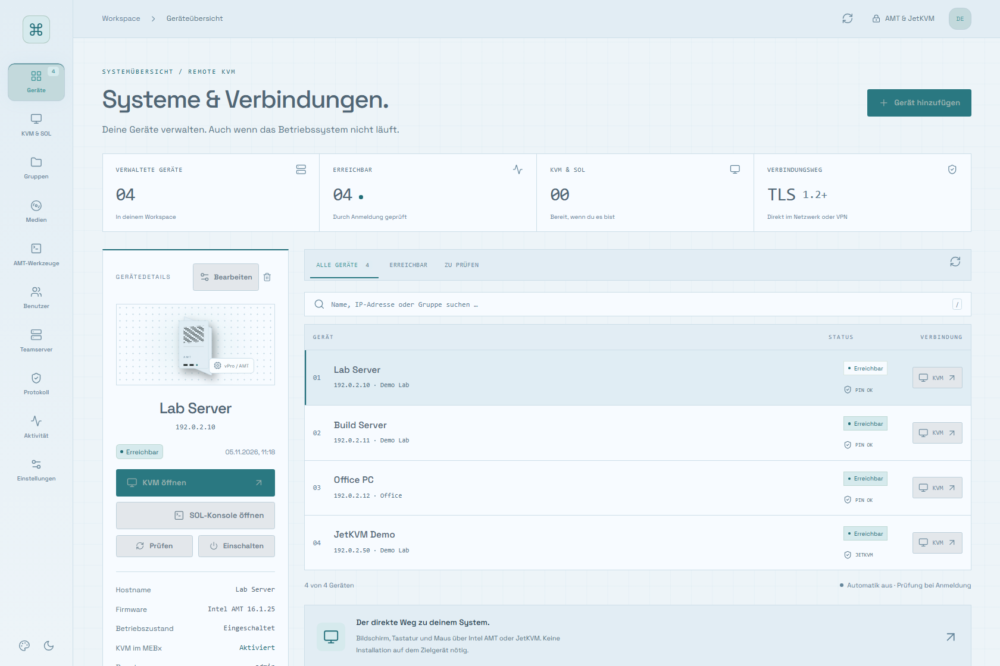
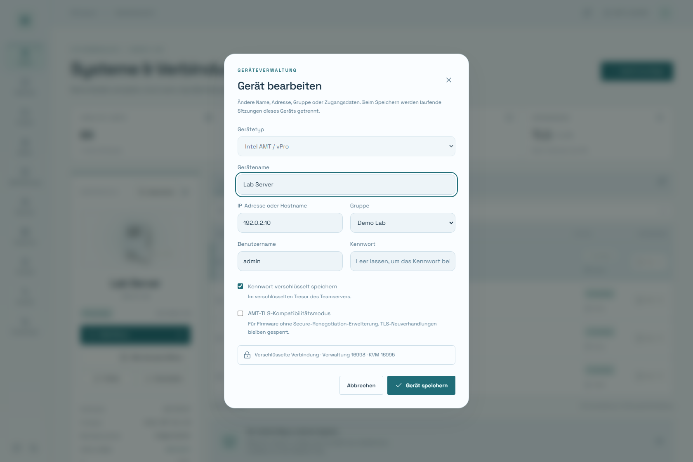

# AMT Studio

**Intel AMT und JetKVM gemeinsam im eigenen Browser-Workspace.**

[English](README.md) · [Docker-Anleitung](docs/INSTALL.md) · [FAQ auf Deutsch](docs/FAQ.de.md) · [Sicherheit](SECURITY.md)

AMT Studio verwaltet Geräte und Gruppen, öffnet KVM-/SOL-Konsolen und stellt virtuelle Medien bereit. Der Teamserver läuft als Linux-Docker-Container auf **ARM64 und AMD64/x86-64**. Bedient wird er im Browser unter Windows, macOS oder Linux. Die Oberfläche ist derzeit deutschsprachig.



Dies ist eine frühe Community-Version (0.3.1) für ein vertrauenswürdiges Verwaltungsnetz oder VPN. Funktionsumfang und Verfügbarkeit hängen von Firmware, Verkabelung und Geräteeinstellungen ab. Das Projekt ist unabhängig von Intel und JetKVM.

## Funktionen

- **Intel AMT:** KVM, Serial over LAN, Stromsteuerung, einmalige Startoptionen, ISO-/IMG-Umleitung und Zertifikatsprüfung.
- **JetKVM:** WebRTC-Bildübertragung, Tastatur und Maus, Medienupload, URL-Medien und ATX-Steuerung mit angeschlossener Platine.
- **Teamverwaltung:** gemeinsame Geräte und Gruppen, Benutzerkonten, Gruppenrechte und verschlüsselte Speicherung der Gerätekennwörter.
- **Darstellung:** drei unterschiedliche Designs mit Hell-/Dunkelmodus, Oberflächengröße von 100 bis 150 Prozent.
- **Status:** Prüfung beim Anmelden und einstellbare automatische Aktualisierung.

JetKVM-Konsolen einschließlich Medien und ATX sind Administratoren vorbehalten. Der Ansichtsmodus sperrt dort die Eingabe in der Oberfläche; er ist keine serverseitig durchgesetzte Nur-Lesen-Berechtigung.

## Drei Designs

Die Aufnahmen wurden mit Beispieldaten erzeugt. Sie enthalten keine echten Geräte oder Zugangsdaten.

| Serein | Luma | Orbit |
| --- | --- | --- |
|  |  |  |
|  |  |  |

## Installation

```sh
git clone https://github.com/LyriC-spec/amt-studio.git
cd amt-studio
cp .env.example .env
```

Zuerst ein TLS-Zertifikat nach der [Docker-Anleitung](docs/INSTALL.md) einrichten. Danach:

```sh
docker compose up -d --build
docker compose exec amt-studio cat /data/setup-token.txt
```

Unter **https://localhost:9443** mit dem einmaligen Einrichtungsschlüssel ein eigenes Administratorkonto anlegen. Es gibt kein Standardkennwort. Für andere Rechner im LAN die Variable `AMT_LISTEN_ADDRESS` in `.env` auf die LAN-Adresse des Docker-Servers setzen.

## Geräte hinzufügen und bearbeiten

Unter **Gerät hinzufügen** den Typ auswählen, Management-Adresse und Zugangsdaten eintragen und speichern. Bei TLS das Zertifikat anhand seines Fingerabdrucks prüfen und bestätigen. Danach **Prüfen** und **KVM öffnen** wählen. Zum Schreiben zuerst **Tastatur & Maus aktivieren**.

Ein bestehendes Gerät in der Übersicht auswählen und **Bearbeiten** anklicken. Name, Adresse, Gruppe und Zugangsdaten sind änderbar; bei JetKVM auch Protokoll und Port. Bei geändertem Zugang muss ein hinterlegtes Kennwort erneut eingegeben werden. Altes Zertifikatsvertrauen und Statuswerte werden zurückgesetzt. Speichern trennt laufende Sitzungen dieses Geräts.



JetKVM bietet **Medien** und **ATX** in der Konsolenleiste. Die Medienbibliothek in der Seitennavigation gehört zu Intel AMT. Ein Upload verbindet noch kein Laufwerk; ein verbundenes JetKVM-Medium bleibt nach dem Schließen der Konsole verbunden.

## Grenzen und Hilfe

AMT muss bereits provisioniert sein. CIRA, Kerberos, automatische Provisionierung, Firmware-Updates, SSO/MFA und Clusterbetrieb sind nicht enthalten. JetKVM benötigt auch vom Browser aus eine direkte LAN-/VPN-Verbindung. Audio und weitere JetKVM-Erweiterungen sind noch nicht integriert.

Antworten zu Zertifikaten, Tastatur, ATX, Medien, Backups und Problemen stehen in der [FAQ](docs/FAQ.de.md). [Testumfang](docs/TESTING.md) und [Sicherheitshinweise](SECURITY.md) beschreiben die Grenzen der bisherigen Prüfung.

## Mitmachen und Lizenz

[Apache-2.0](LICENSE); Fremdkomponenten behalten ihre jeweiligen [Lizenzen](THIRD_PARTY_NOTICES.md). Entwickelt mit Unterstützung von OpenAI Codex. Fehlerberichte und Beiträge sind willkommen. Bitte keine Kennwörter, echten Management-Adressen oder Bilder privater Systeme in öffentliche Issues einfügen.
