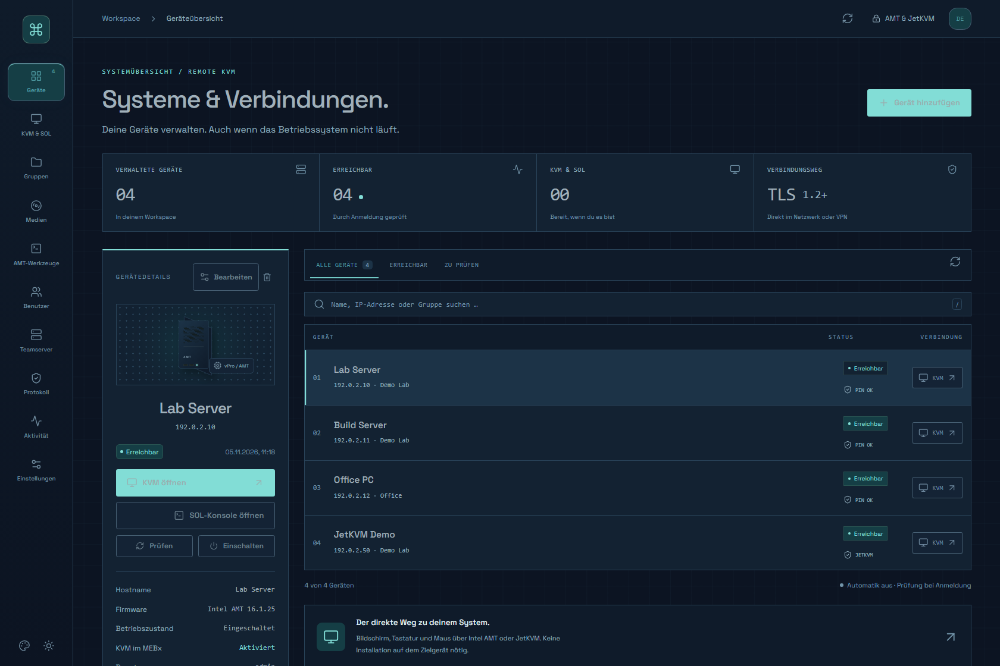
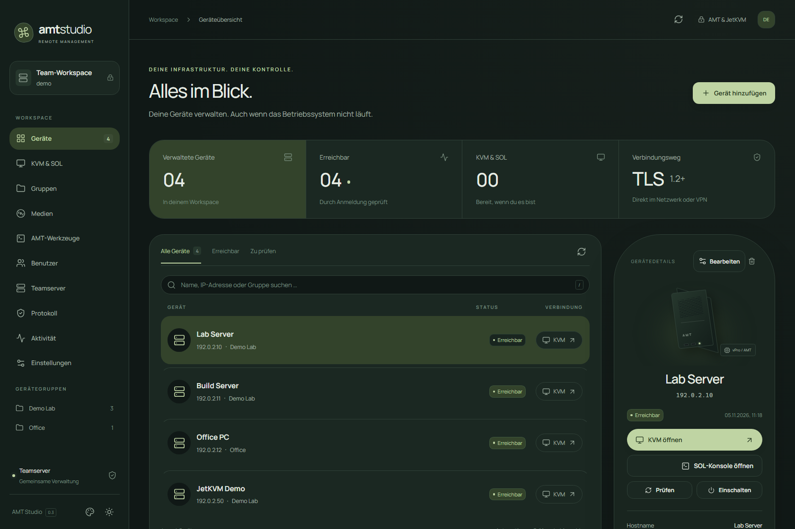
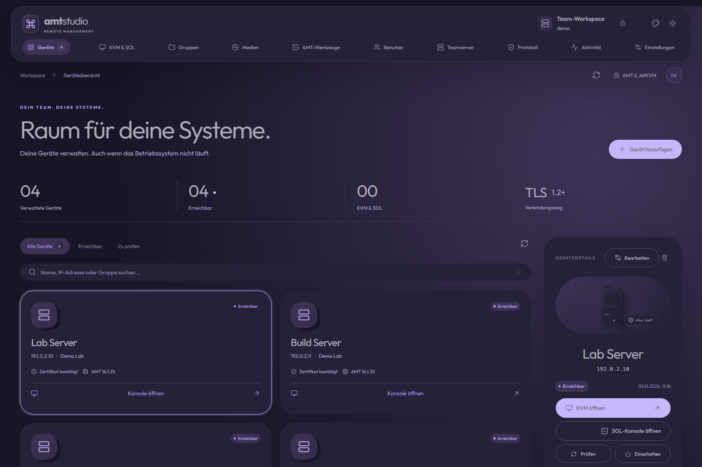
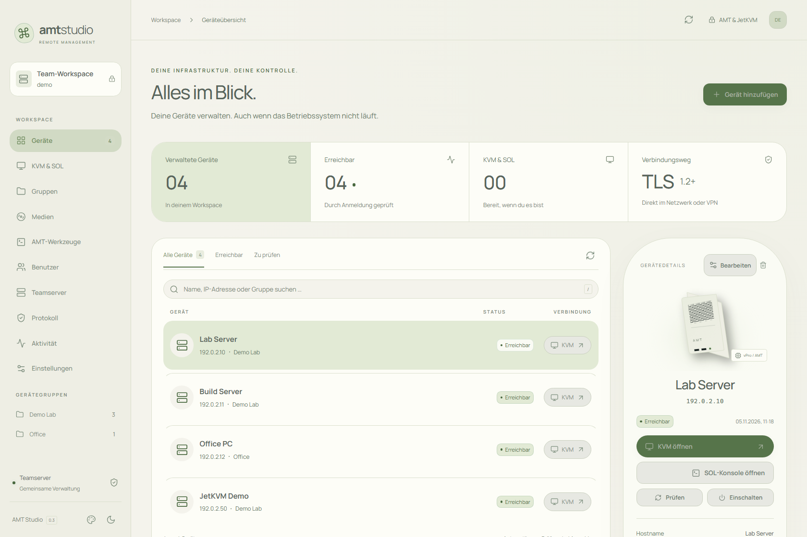
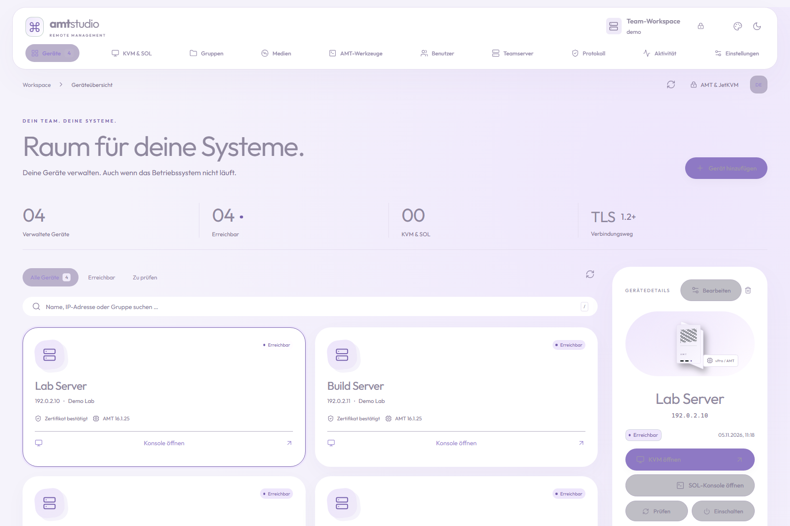
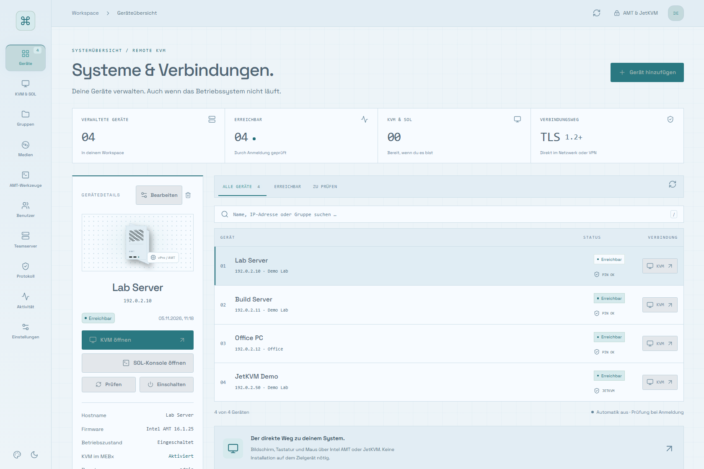

# AMT Studio

**Intel AMT and JetKVM, together in a self-hosted browser workspace.**

[Deutsch](README.de.md) · [Docker installation](docs/INSTALL.md) · [FAQ](docs/FAQ.md) · [Security](SECURITY.md) · [Contributing](CONTRIBUTING.md)

Manage devices, open remote consoles and share access with your team. AMT Studio runs as a Linux Docker container on **AMD64/x86-64 and ARM64**, with a browser on Windows, macOS or Linux. The interface currently uses **German labels**.



> Early community release, version 0.3.0. Use on a trusted management network or VPN. Hardware support depends on device firmware and provisioning. This is an independent project, not affiliated with Intel or JetKVM.

## What it does

| Feature | Intel AMT | JetKVM |
| --- | --- | --- |
| Device inventory, groups, editable addresses | Yes | Yes |
| Browser video, keyboard and mouse | KVM over AMT redirection | Direct WebRTC |
| German / US / physical keyboard mapping | Yes | Yes |
| Serial console | SOL | Not implemented |
| Virtual media | Teamserver ISO/IMG library, read-only redirection | Device storage uploads or HTTP/HTTPS URLs |
| Power controls | Power on, off, restart | Short/long Power and Reset with a wired ATX board |
| Shared users and permissions | Per-group permissions | Console/media/ATX restricted to administrators |
| Certificates and credentials | TLS certificate pinning, encrypted vault | HTTP or HTTPS, optional certificate pinning, encrypted vault |

- Three different layouts: **Serein**, **Luma** and **Orbit**, each in light and dark mode.
- Adjustable interface scale from 100% to 150%.
- Status checks at login and a configurable refresh interval.
- Consoles start with keyboard and mouse disabled. Enable input explicitly.
- Confirmation dialogs for power, media and other device changes.
- No cloud account or external font service required.

### Three designs, two modes

All screenshots use fictional devices and documentation-only addresses. They are not captures of a real installation.

| Serein | Luma | Orbit |
| --- | --- | --- |
|  |  |  |
|  |  |  |

## Start with Docker

You need Docker Engine with Compose v2, a TLS certificate and network access to your management devices. The full guide covers Linux, Docker Desktop, first login, updates and backups.

```sh
git clone https://github.com/LyriC-spec/amt-studio.git
cd amt-studio
cp .env.example .env
```

Follow [TLS setup](docs/INSTALL.md#2-create-or-install-a-tls-certificate), then:

```sh
docker compose up -d --build
docker compose exec amt-studio cat /data/setup-token.txt
```

Open **https://localhost:9443**. Verify your certificate, use the one-time setup token and create your own administrator account. There is **no default password**. By default the published port is bound to localhost; set `AMT_LISTEN_ADDRESS` in `.env` to your server's LAN address for access from other computers.

For prebuilt image archives, see [container releases](docs/INSTALL.md#prebuilt-release-image). Download the archive matching your Docker host's architecture.

## First device

1. Select **Gerät hinzufügen** → **Intel AMT / vPro** or **JetKVM**.
2. Enter its management address, group and credentials.
3. For AMT or JetKVM HTTPS, verify and confirm the device certificate.
4. Select **Prüfen**, then **KVM öffnen**. AMT also offers **SOL-Konsole öffnen**.
5. Select a device and click **Bearbeiten** to change its name, address or credentials later.

For JetKVM, **Medien** and **ATX** are inside its console toolbar. The main **Medien** navigation entry is the separate AMT library. Uploading an image does not automatically mount it. A JetKVM image remains mounted after the console closes.

## Limits to know

- AMT must already be provisioned and permit the requested services. CIRA, Kerberos, provisioning and firmware updates are not included.
- JetKVM uses direct browser-to-device WebRTC. A reachable teamserver alone is insufficient; the browser also needs a LAN/VPN path to the device. No TURN relay is provided.
- JetKVM console access is administrator-only. Its “Nur ansehen” mode is a UI input lock, not a server-enforced read-only security boundary.
- JetKVM audio, DC power, serial extensions and general device settings are not implemented. ATX requires the physical board and wiring.
- No SSO, MFA or multi-writer cluster support. Run one server instance per data volume.
- The vault key is stored with the server data. Encryption does not protect against an attacker who has both the data volume and its key.

## Development and verification

Use Node.js 24 and OpenSSL for the TLS integration tests.

```sh
npm ci
npm run build
npm test
npx playwright install chromium
npm run test:browser
npm run check:public
```

`npm run docs:screenshots` regenerates the design screenshots from isolated synthetic fixtures. It does not contact management hardware. Browser tests also use simulated devices and temporary data directories. See [verification notes](docs/TESTING.md) for what has and has not been hardware-tested.

## License and credits

[Apache-2.0](LICENSE). Third-party components retain their own licenses; see [notices](THIRD_PARTY_NOTICES.md). The KVM/media decoder uses Device Management Toolkit; terminal rendering uses xterm.js. React, Lucide and locally bundled fonts provide the interface.

Built with assistance from OpenAI Codex. Contributions and reproducible bug reports are welcome; please remove credentials, real device addresses and screenshots of private systems before posting.
